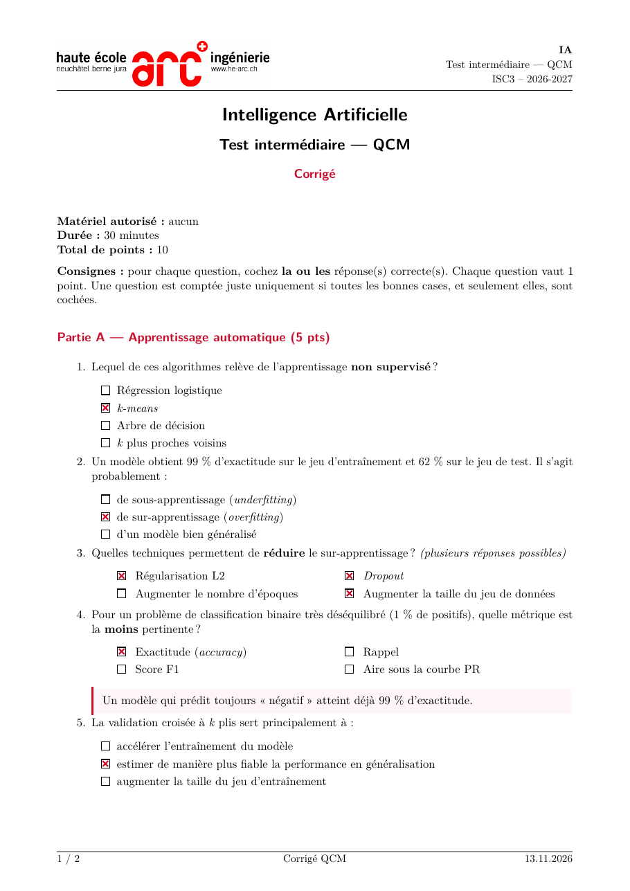

# Thème HE-Arc Ingénierie pour examens — extension Quarto

Ce format Quarto produit, à partir d'un seul fichier `.qmd`, l'**énoncé** d'un examen HE-Arc (avec des boîtes de réponse) et son **corrigé** (avec les solutions), tous deux en PDF.

<p align="center">
  
  &nbsp;
  
</p>
<p align="center"><em>À gauche : énoncé (<code>example/CP_exemple.qmd</code>). À droite : corrigé d’un QCM sur deux colonnes (<code>example/QCM_exemple.qmd</code>).</em></p>

## Installation

Dans un nouveau dossier, pour récupérer le gabarit complet (extension, `_quarto.yml` et `CP_exemple.qmd`) :

```bash
quarto use template fabrizioalbertetti/quarto_theme_hearc_exams
```

Pour ajouter seulement l'extension à un projet existant :

```bash
quarto add fabrizioalbertetti/quarto_theme_hearc_exams/extension
```

## Utilisation

```bash
quarto render CP_exemple.qmd                                   # énoncé + corrigé
quarto render CP_exemple.qmd --to theme-hearc-exams-pdf           # énoncé seul
quarto render CP_exemple.qmd --to theme-hearc-exams-pdf+solution  # corrigé seul
```

Les variables de l'examen se trouvent dans l'en-tête YAML du `.qmd` :

```yaml
---
title: "Intelligence Artificielle"     # nom du cours (titre du document)
subtitle: "Contrôle Principal"         # facultatif : sous le titre et dans l'en-tête

exam:
  short: IA               # nom court du cours dans l'en-tête (défaut : title)
  classe: ISC3
  annee: 2026-2027
  date: 08.01.2027        # pied de page à droite
  type: CP                # pied de page du corrigé : "Corrigé CP"
  materiel: aucun
  duree: 90 minutes
  instructions:           # consignes, affichées en liste sous « Consignes : »
    - Merci de rendre la donnée à la fin du CP.
    - Utiliser un stylo de couleur **bleue** ou noire.
  # points: auto         # par défaut : somme des "(N pts)" des titres et questions
  nom: true               # cadre NOM / Prénom dans l'énoncé
  # logo: mon-logo.png    # par défaut : logo HE-Arc fourni par l'extension

format:
  theme-hearc-exams-pdf:                # énoncé
    output-file: CP_exemple.pdf
  theme-hearc-exams-pdf+solution:       # corrigé
    output-file: CP_exemple_solution.pdf
    metadata:
      solution: true                    # indispensable pour obtenir le corrigé
---
```

Les variables communes à plusieurs examens (par exemple `exam.classe` ou `exam.annee`) peuvent être déplacées dans `_quarto.yml`. Les valeurs du `.qmd` ont la priorité.

Le bloc « Matériel autorisé / Durée / Total de points », la liste des consignes (`exam.instructions`) et le cadre NOM / Prénom sont générés automatiquement en début de document à partir de ces variables. Une variable absente fait disparaître sa ligne. `exam.instructions` accepte une liste (une puce par consigne) ou un texte simple (une seule puce) ; le Markdown y est interprété (`**gras**`, `*italique*`).

### Total de points automatique

Si `exam.points` est absent (ou vaut `auto`), le total est la somme des points indiqués dans les titres, sous la forme `(4 pts)` ou `(1 pt)`, décimales acceptées (`(1.5 pts)` ou `(1,5 pts)`) :

```markdown
## Exercice 1 (4 pts)
### a) (1 pt)        <- non additionné : son parent « Exercice 1 » compte déjà
## Exercice 2 (6 pts)
```

Ici, le total vaut 10.

Pour un examen sans titres (simple liste de questions), les points peuvent être placés au début de chaque question numérotée, y compris dans `::: {.colonnes}` et `::: {.qcm}` :

```markdown
1. (2 pts) Quel est le résultat de…
2. (1,5 pt) Expliquer…
   a. (1 pt)          <- non additionné : sa question parente compte déjà
```

Ici, le total vaut 3,5. Le contenu des solutions (`::: {.sol}`) est ignoré.

`quarto render` affiche un avertissement si `exam.points` est renseigné et diffère de cette somme, ou si `auto` ne trouve aucun point (la ligne « Total de points » n'est alors pas affichée).

## Syntaxe dans le `.qmd`

| Syntaxe | Énoncé | Corrigé |
|---|---|---|
| `::: {.sol reponse="3cm"}` … `:::` | boîte de réponse vide (3 cm par défaut) | contenu sur fond rouge pâle, filet rouge à gauche |
| `::: {.sol reponse="0"}` … `:::` | rien | idem (p. ex. justification d'un QCM) |
| `::: {.qcm}` + liste `- [ ]` / `- [x]` | cases vides | bonnes réponses cochées en rouge |
| `::: {.qcm colonnes="2"}` | réponses en grille sur 2 colonnes | idem |
| `::: {.colonnes n="2"}` … `:::` | contenu (p. ex. questions) sur n colonnes (2 par défaut) | idem |
| `::: {.exam}` … `:::` | contenu encadré | masqué |
| `\sautpage` | saut de page | rien |
| `[texte]{.rouge}` (`.bleu`, `.vert`, `.orange`, `.gris`) | texte en couleur | texte en couleur |

### QCM

```markdown
1. Lequel de ces algorithmes relève de l'apprentissage **non supervisé** ?

   ::: {.qcm colonnes="2"}
   - [ ] Régression logistique
   - [x] *k-means*
   - [ ] Arbre de décision
   - [ ] *k* plus proches voisins
   :::

   ::: {.sol reponse="0"}
   Justification affichée uniquement dans le corrigé.
   :::
```

La question et ses réponses ne sont jamais séparées par un saut de page. Voir `example/QCM_exemple.qmd` pour un examen QCM complet.

#### QCM sur deux colonnes

Pour gagner de la place, entourez les questions d'un bloc `.colonnes` :

```markdown
## Partie A (5 pts)

::: {.colonnes n="2"}
1. Première question …

   ::: {.qcm}
   - [ ] …
   :::

2. Deuxième question …
:::
```

- `n` donne le nombre de colonnes (2 par défaut).
- Une question n'est jamais coupée entre deux colonnes : son texte, ses réponses et sa justification restent ensemble.
- Un titre placé juste avant le bloc reste sur la même page que les colonnes. Les colonnes commencent sur une nouvelle page s'il reste moins de 10 lignes.
- Dans une colonne étroite, préférez une liste simple (`{.qcm}`) ou `colonnes="2"` à `colonnes="4"` pour les réponses.
- `\sautpage` ne doit pas se trouver dans un bloc `.colonnes`. Fermez le bloc avant (voir les parties A et B de `example/QCM_exemple.qmd`).

### Diagrammes draw.io (et SVG)

Un diagramme draw.io enregistré au format `.drawio.svg` s'inclut directement, sans export manuel :

```markdown
{width=75% fig-align="center"}
```

- Le fichier reste éditable dans draw.io : dans VS Code, avec l'extension *Draw.io Integration* (`hediet.vscode-drawio`), ou sur app.diagrams.net.
- À chaque rendu, le SVG est converti en PDF avec le Typst fourni par Quarto, sans outil à installer (ni Inkscape, ni rsvg-convert). Le PDF généré (`arbre-decision.drawio.pdf`) est écrit à côté du SVG et ignoré par git.
- Les libellés doivent être en **texte simple**. Dans draw.io, décochez *Formatted Text* (style `html=0`) : les libellés HTML ne sont pas rendus hors d'un navigateur.
- Une image seule dans son paragraphe reste sur la même page que le texte qui la précède.

Voir l'exercice 4 de `example/CP_exemple.qmd`.

### TikZ

Les styles TikZ `aut`, `op` et `couture` (bibliothèques `automata`, `positioning`, `arrows.meta`) sont chargés automatiquement.

## Fichiers de l'extension

```
_extensions/theme-hearc-exams/
├── _extension.yml        format theme-hearc-exams-pdf (KOMA scrartcl, A4, marges, filtres)
├── hearc-exam.tex        en-tête/pied, boîtes, couleurs, TikZ
├── solution.lua          énoncé/corrigé, variables exam.*, bloc d'informations
├── couleurs.lua          [texte]{.couleur}
├── svg.lua               SVG / .drawio.svg -> PDF via Typst
└── logo-he-arc-ing.jpg
```
